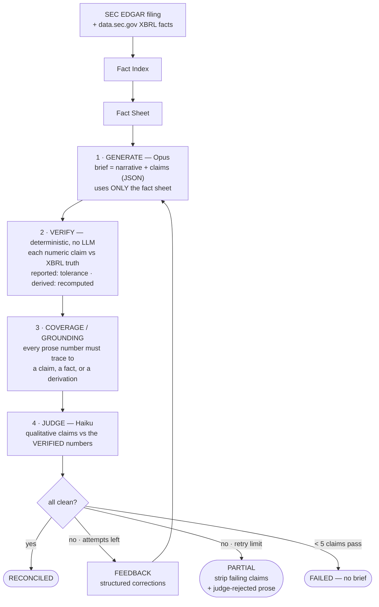

# Design decisions

Technical record of the choices that shaped slice 1, including what real data forced. This file
is publishable; it contains no project-external context.

## Architecture

### At a glance

*The judge runs only once the numbers are clean — a failure at any stage routes to Feedback and regenerates (numbers are fixed before judgment). The **routing wall** (D4): numeric claims are verified in code or dropped; they never reach the judge. Max 3 attempts; all model calls are disk-cached under a `--max-spend` hard abort.*

**D1 — Generate from the fact sheet, verify against the fact index (independent paths).**
Both the generation input (a rendered fact-sheet table) and the verification ground truth (the
fact index) derive from `data.sec.gov` company-facts JSON, through separate code paths
(`facts.render_fact_sheet` vs `facts.FactIndex` + `verify`). This removes the hardest problem —
mapping free-text claims to XBRL — from the critical path while keeping the loop honest: the
model can still transcribe wrong, cite the wrong period, import numbers from memory, or botch
derived math, and the verifier catches all four. **v2 grounds generation on filing text**;
the README states the limitation.

**D2 — Claims-first structured generation, not post-hoc extraction.** The brief is generated as
a structured object: narrative markdown plus a machine-readable `claims[]` array (us-gaap tag,
exact period dates, unit, value, derivation for computed figures). A deterministic sweep over
the narrative flags any number without a backing claim (`unclaimed_numeric`) — no fragile NLP
extraction stage.

**D3 — One brief per company.** 8 independent reconcile data points beat one cross-company
brief (one data point, multiplied fiscal-calendar misalignment risk).

**D4 — The routing wall.** Numeric/GAAP claims go to the deterministic verifier or are DROPPED —
they never fall through to the LLM judge. The judge sees only qualitative claims (materiality,
tone, why-it-matters). The deterministic-vs-judge routing share is measured and reported per
brief, not asserted.

**D5 — Tickers are data-driven, not sacred.** The coverage matrix (`harness coverage`) decides;
any ticker with weak tag resolution gets swapped, never special-cased. No banks/insurers in the
slice (non-standard income-statement tagging).

**D6 — Mock-first.** `--mock` injects three known fault classes (value perturbation, shifted
period, unclaimed narrative number), must reconcile on attempt 1, and is byte-deterministic —
the whole pipeline including reports is validated before the first paid call. All model calls
are disk-cached; a usage ledger enforces `--max-spend` as a hard abort.

**D7 — Narrative grounding is TYPED, separate from claim verification, and auditable.** Every
prose number must trace to a claim value, an XBRL fact, or a *semantically typed* derivation —
same-concept period-over-period delta/growth, revenue-denominated margins, same-margin pp/bp
deltas — and each grounded token is logged with the provenance it matched (`grounded` rows in
the droplog). Two designs were tried and rejected on measurements. (a) Grounding against formal
claim values only: every prior-year comparative and derived figure the analyst cites without
formally claiming flags as `unclaimed_numeric`, and regeneration reintroduces new ones — the
loop chases its tail to retry exhaustion (first real run: a fully-verified brief scored
`PARTIAL` at 52% coverage). (b) Grounding against all-pairs arithmetic over the fact base: 24
facts expand to ~460k values, dense enough that **100% of random numbers passed** — a gate that
cannot fail is not a gate. Typed derivations keep the set ~200 entries, and %-suffixed tokens
may only ground against percentage-typed entries (a "24.5%" landing near a $24.78B fact scaled
to billions is a coincidence, not traceability). Measured false-ground rates on random inputs:
~28% for %-tokens, ~12% bp-scale, ~26% dollar-scale. Grounding is a tripwire for stray numbers;
the strict layer remains per-claim verification (D4), untouched by any of this.

**D8 — The judge runs inside the retry loop, and nothing the judge rejected ships.** The judge
fires the moment numbers are clean, and judge rejections get the same regeneration budget as
numeric failures (numbers first, then judgment — a qualitative claim can't be judged against
unverified figures). On retry exhaustion: if the numbers never came clean, the judge still runs
once on the stripped brief — a PARTIAL must not ship unjudged qualitative claims; any claim the
judge refuses is removed from both the claims array and the narrative (`_strip_qualitative`).
The first real run motivated this: the retry budget was consumed by the (a)-era coverage
treadmill, and the emitted brief still contained a "near-doubling" phrase its own judge had
flagged as overreach.

**D9 — Prove citation integrity on real data, not only under `--mock`.** On the clean real
filing set the verifier never fires `wrong_tag` / `wrong_period` — the model cites its numbers
correctly — so the citation-integrity guarantee (D4, and the verification policy below) is
*exercised* only by synthetic mock faults. `harness adversarial` (`src/harness/adversarial.py`)
closes that gap: it takes a real Opus brief (served from the local cache → $0) over real XBRL,
picks a claim the model got right, and changes exactly one thing at a time — first the cited
period (shifted back one year), then the cited us-gaap tag — leaving the correct number
untouched. The same deterministic verifier flips the claim red (`wrong_period`, then
`wrong_tag`) and returns it green once the citation is restored; one variable per step, so the
flip is unambiguous. This makes the "own the null" point concrete: a verifier that catches
nothing on the clean set is not inert — the same gate holds a cheaper, future, or drifted model
to the identical bar. The mock proves the gate fires, the clean run proves it does not
false-positive, and this proves it fires on *real* facts. Budget-safe by construction: default
`--max-spend 0`, cache-only, with a clean abort if the generation is not cached; `--allow-spend`
permits one live Opus call.

**D10 — Cost accounting states what a number represents.** Every model call is disk-cached, so a
`--real` re-run whose calls all hit the cache spends $0 — truthful, but a bare "(real) … $0.00"
reads as *free* when the cold run cost ~$1.13. The ledger now distinguishes `live_calls` from
`cache_hits`: a real run with zero live calls is labeled `real · cache-served` and its spend line
says so explicitly ("a re-run over cached generations, not cold-run cost"). Separately, per-brief
cost and tokens had been captured only at the aggregate level (Finding 3, first real run);
`run_ticker` now snapshots the shared ledger and records each brief's own delta, so per-ticker
`metrics.json` cost is real rather than zero. The README's machine-rendered metrics stay honest
about *what* each figure represents, not only its value.

**D11 — Provider seam; the Gemini API is the supported default (2026-07-31).** All vendor-SDK
contact now lives in one module (`providers.py`) behind a two-method client protocol; the
generator and judge are provider-blind, and the disk cache keys on `(model, system, user,
max_tokens)` — provider-agnostic by construction, so every prototyping-era entry replays
unchanged. Default models: `gemini-3.6-flash` for both generation and judging, chosen as the GA
flagship over a `-preview` id (a shipped default should not churn). The Anthropic adapter stays
behind the same seam (`--provider anthropic`): it replays the measured runs recorded in this
document at $0 and keeps the harness's core claim honest — model-independence is architectural,
not asserted. Clients initialize lazily, so fully-cached replays need no API key at all.
Consequence tracked for the record: detection numbers (docs/DETECTION.md) were measured with the
`claude-haiku-4-5` judge; any judge-model change re-runs the measurement before those numbers are
cited for the new configuration (the eval-audit F7 trigger).

## Verification policy

- Reported values: 0.5% relative tolerance (absorbs "$94.9B"-style rounding; delta always logged).
- Diluted EPS: $0.005 absolute.
- Derived percentages: recomputed from ground-truth fact values via a safe arithmetic evaluator
  (`+ - * /` and parens over fact_ids only), ±0.5pp absolute.
- Citation integrity: a correct number citing the wrong fact/tag/period still fails
  (`wrong_tag` / `wrong_period`).
- Unresolvable claims are `unverifiable` → dropped with reason, never guessed, never judged.

## What real EDGAR data forced (found on day 1 by the coverage matrix)

1. **Ticker → successor-CIK trap.** XOM's ticker now resolves to a successor holding-company CIK
   with no 10-Q/K under it yet (8-K12B). Swapped to CVX. Lesson: always resolve tickers at run
   time and let the coverage matrix veto.
2. **52/53-week retail calendars.** Costco's 12/16-week quarters and 24/36-week YTDs
   (84/112/168/252 days) fell outside naive period bands; bands widened
   (Q: 80–120d, H1: 160–195d, 9M: 245–295d, FY: 350–380d).
3. **Bottom-line tag variance.** CAT tags net income as `ProfitLoss`, not `NetIncomeLoss` —
   handled by the per-concept synonym chain; the resolved tag is recorded on every fact and claim.
4. **Genuinely absent concepts.** JNJ and CVX don't tag `OperatingIncomeLoss` at all; such
   concepts are marked optional rather than approximated with a different-concept synonym.
5. **`fy`/`fp` labeling trap.** EDGAR's company-facts `fy`/`fp` describe the filing a fact was
   *reported in*, not the fact's own period — a prior-year comparative re-reported in the current
   10-Q carries the current fy/fp. All period labels are derived from the fact's own dates;
   matching never uses labels.
6. **Cash flow is YTD-only in most 10-Qs.** Cash-flow concepts accept H1/9M durations when no
   quarterly duration exists (`ytd_ok`), preferring the shortest available.
7. **8-K exclusion (by design, pre-build).** Earnings exhibits in 8-Ks are furnished, not filed —
   no contemporaneous XBRL exists to verify against; real XBRL arrives with the 10-Q/K.

## Tracking convention

- Technical decisions: this file + commit messages.
- Consumer-facing behavior + metrics: `README.md` (the `<!-- metrics -->` block is
  machine-rendered by `harness run`).
- Work items after the repo is public: GitHub issues.
